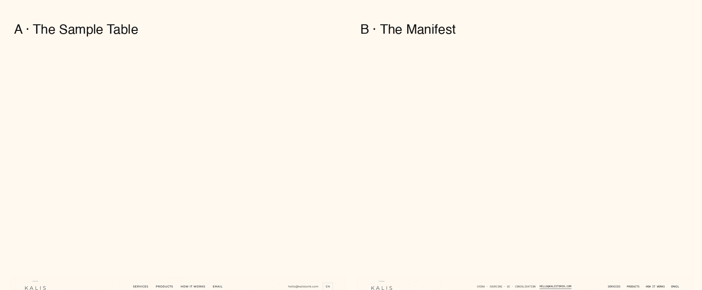

# KALIS TORIK · 首页两套方向（2026-11-06）

> **已否决，仅留档。** 2026-11-06 23:07，老板明确否决 A/B 整页方向稿，评分 0/100：整页结构被打乱、元素像拼凑、没有逻辑和理由。禁止继续开发、展示为推荐方案或上线。下次从 `../../CURRENT-HANDOFF.md` 接手。

状态：历史方向稿，已过技术/文案/视觉三方验收，但被老板否决。线上站未改。
用途：只用于回看当时的失败方向，不作为生产模板。

## 先看结论

**推荐以 B《The Manifest》为上线基底，借 A 的首屏大图和材质样卡做视觉补强。**

- B 的服务表、三类客户起点、场景卡（Starting point / What we handled / Output）在 10 秒内说清“中间商能做什么”，最符合服务第一、产品第二。
- A 的首屏最有温度，亮色空间图 + 悬浮样卡 + INSPECTED 章最容易记住；但信息密度低于 B，单独做首页偏“作品集”。
- 两套都已明确写：不拥有工厂，只管理工厂之间的路线。避免被误读为工厂主或自有品牌。

## 两套方向

| | A · The Sample Table | B · The Manifest |
|:--|:--|:--|
| 核心感觉 | 编辑式、暖、像一本材料样本册 | 结构式、像出口单据/采购清单 |
| 首屏 | 大幅空间图 + 悬浮沙发样卡 + 检验章 | 整幅空间图 + 三张带 REF 编号的样品卡 |
| 服务 | 大行列表，语气偏品牌 | 采购单表格，带 Stage 列，最清楚 |
| 产品 | 横向滚动卡带 | 12 栅格杂志拼贴 |
| 适合 | 想让客户先记住气质 | 想让客户先看懂能力与流程 |
| 风险 | 样卡段偏装饰，信息密度低 | 表格感强，情绪温度低于 A |

## 这次修掉的问题

- 首屏标语曾被读成“自有工厂”：两页 Why 区已加明确句 `We do not own the factories; we manage the route between them.`
- A 的空泛文案：`Curve, softened.` → `Curve, checked.`；`The sample table` → `The detail check`。
- B 的 `KT-01 / KT-P01` 像自有品牌 SKU：全部改为中性的 `REF-00 / REF-01…05`。
- B 的大黑块与“亮丽、不暗沉”冲突：Why 区改为天空蓝，保留深色只做细分割条。
- A 移动端页头在 768px 下 Chrome 只排版不绘制 Email：页头改 flex，390/360/768 均已像素级复核。
- 页脚 `#` 空链接：换成 LinkedIn / Instagram / Facebook 真实账号。
- 产品图 `loading="lazy"` 在横向卡带里会造成空白：静态稿改为立即加载，保证验收截图完整。

## 验收结果

| 验收方 | 范围 | 结果 |
|:--|:--|:--|
| 玛门 | H1/alt/链接/复制按钮/console/5 档宽度/Logo/HTML/CTA | 9/9 PASS（最终文案版）+ 页头像素复核 PASS |
| 路西法 | 定位、overclaim、AI 味、工厂主歧义、SKU 感 | 4/4 PASS，无残留误导 |
| 米迦勒 | 1440/1024/768/390/360 视觉与断点 | 通过；无页面横向溢出；A 移动端页头已肉眼复核 |

报告：`qa/qa-mammon-final.md`、`qa/qa-lucifer-final.md`、`qa/qa-mammon-header.md`

## 设计规则（已落地）

- 定位：中国家具采购服务商；服务第一、产品第二；不写成 IKEA 式商城。
- 主标语：`Furniture sourcing, inspection and consolidation — one team, many factories.`
- 主 CTA：`Email your brief`，全站只走邮件，不做下单/价格/多步骤询盘。
- 客户：欧美中小买家；公开页面不写地域限制。
- 视觉：亮黄 `#FFD866`、天蓝 `#9DD9F3`、珊瑚 `#FF927D`、鼠尾草 `#B7D6A8`、淡紫 `#C9B8E8`；暖白 `#FFF9F0`。
- 金色 `#C9A96E` 不进入 UI；Logo 冠线 `#888`，KALIS `#000`，TORIK `#888`。
- 图片：只用现有站内图/国内免费图库；无人物、无脸、无手、无工厂信息、无品牌 Logo。
- 语言：英文母版；FR / DE / IT / ES / PT 六语同步，页脚已列全。

## 下一步（小步走，不并行）

| 步 | 做什么 | 产出 | 验收 |
|:--|:--|:--|:--|
| 1 | 定基底：默认 B；把 A 的首屏图法和材质带列为可选模块 | 一页选型确认 | 老板点头 |
| 2 | 冻结英文文案：只改字，不动布局 | copy deck v1 | 路西法过一遍 overclaim/AI 味 |
| 3 | 六语本地化：术语统一，先机翻后人工校 | 6 份文案 | 每语抽 3 句回译检查 |
| 4 | 接生产模板：保留现有 URL/SEO/GA4/邮件入口，先 staging | staging 链接 | 玛门跑链接/表单/404 |
| 5 | 图片补强：3–5 张 2400px 场景 + 6–8 张材质微距 | 图片集 + alt | 无人物/工厂信息，欧美不易撞图 |
| 6 | 三方验收 → 备份 → 上线：技术/文案/视觉各一轮 | 上线版 + 备份 | 上线后 24h 看 404、表单、收录 |

第一步只做一件事：确认 B 为基底（或改选 A）。确认后再开第 2 步，避免边做边改。

## 文件

- `direction-a/index.html` + `style.css` — The Sample Table
- `direction-b/index.html` + `style.css` — The Manifest
- `assets/images/` — 9 张站内复用图
- `screenshots/` — 首屏对比、手机对比（全页截图保留在本机交付目录，未入库以控制体积）
- 设计法典与决策记录：`../../DESIGN-SYSTEM.md`、`../../DECISION-LOG.md`
